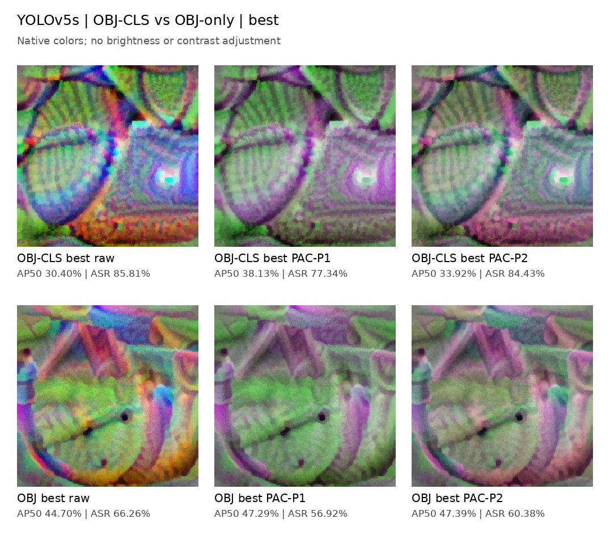
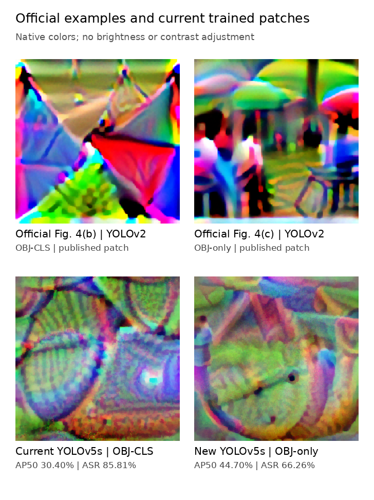

# YOLOv5s AdvPatch OBJ-only 与 OBJ-CLS 对照

物理 GPU 7。OBJ-only 从灰色补丁训练 200 轮，共 15,400 次更新；没有测试集选模。
OBJ-only best 为第 195 轮；OBJ-CLS 复用 s000，第 199 轮 best，并重新评估。
仅检测项从 max(obj×person probability) 改为 max(obj)。NPS 0.01、max(2.5×TV,0.1)、EOT、图像预处理与贴图规则保持一致。
训练：614 图，seed 1788272031，batch 8，Adam AMSGrad lr 0.03，ReduceLROnPlateau patience 50，640 输入，300×300 补丁，人体框面积 25%。
评估：人工 GT，288 图/589 人体；conf 0.001、NMS IoU 0.6、max_det 300、batch 8、无 EOT。ASR 为干净可检出的 578 个 GT 中补丁导致漏检的比例，匹配阈值 conf/IoU 均为 0.5。

## 按训练损失选择 best

| 方法 | mAP50 (%) ↓ | 相对 Clean 下降 (百分点) ↑ | mAP50–95 (%) ↓ | ASR (%) ↑ |
|---|---:|---:|---:|---:|
| clean | 95.70 | 0.00 | 64.54 | 0.00 |
| gray | 42.78 | 52.92 | 25.81 | 31.14 |
| obj_cls_best_raw | 30.40 | 65.30 | 11.43 | 85.81 |
| obj_cls_best_p1 | 38.13 | 57.57 | 17.05 | 77.34 |
| obj_cls_best_p2 | 33.92 | 61.79 | 13.55 | 84.43 |
| obj_best_raw | 44.70 | 51.01 | 18.03 | 66.26 |
| obj_best_p1 | 47.29 | 48.41 | 23.23 | 56.92 |
| obj_best_p2 | 47.39 | 48.31 | 21.20 | 60.38 |

## 最后第 200 轮

| 方法 | mAP50 (%) ↓ | 下降 (百分点) ↑ | mAP50–95 (%) ↓ | ASR (%) ↑ |
|---|---:|---:|---:|---:|
| obj_cls_last_raw | 31.20 | 64.51 | 11.70 | 85.81 |
| obj_cls_last_p1 | 38.42 | 57.28 | 17.13 | 77.34 |
| obj_cls_last_p2 | 34.28 | 61.42 | 13.72 | 84.26 |
| obj_last_raw | 45.41 | 50.29 | 18.60 | 66.26 |
| obj_last_p1 | 48.02 | 47.69 | 23.98 | 57.79 |
| obj_last_p2 | 48.20 | 47.50 | 22.29 | 59.00 |

## 换色保留性

保留率 = 换色后的 AP50 下降 / 原补丁 AP50 下降 × 100%。两套固定色板 Bc1/Bc2 均使用原有 RGB 线性换色公式，不归一化通道、不训练新补丁。

| 目标 | 选择 | 换色 | 相对原补丁 AP50 变化 (百分点) | AP50 下降保留率 (%) |
|---|---|---|---:|---:|
| obj_cls | best | p1 | +7.73 | 88.17 |
| obj_cls | best | p2 | +3.51 | 94.62 |
| obj_cls | last | p1 | +7.22 | 88.80 |
| obj_cls | last | p2 | +3.09 | 95.21 |
| obj | best | p1 | +2.59 | 94.92 |
| obj | best | p2 | +2.70 | 94.71 |
| obj | last | p1 | +2.60 | 94.83 |
| obj | last | p2 | +2.79 | 94.46 |

OBJ-only best 的 AP50 相对 OBJ-CLS best 变化为 +14.29 个百分点；负值表示本次攻击更强。此结论限定为当前 YOLOv5s、单个固定种子的白盒对照。
OBJ-only best 的 AP50 相对 Gray 为 +1.92 个百分点，ASR 相对 Gray 为 +35.12 个百分点。AP 衡量整条精确率-召回率曲线，ASR 使用固定置信度/IoU 阈值，因此两者可能给出不同排序。
上述换色保留率以 Clean 为基线，包含补丁遮挡带来的性能下降；高保留率本身不能证明强于灰色遮挡。应结合 Gray 和原补丁的绝对 AP/ASR 一起解释。各下降值使用未舍入数值计算，显示值相加可能有 0.01 的舍入误差。

## 补丁图

官方上排为原论文 Figure 4(b)/(c)，使用 YOLOv2；本地下排使用 YOLOv5s。图片只用于外观比较，不能将跨模型和跨协议的差异单独归因于损失函数。
本次保留现有 PAC 的 GT 贴图、面积和旋转实现，是检测损失的受控对照，不是作者 YOLOv2 全协议的逐项重放。

## 文件与验证

- [全部指标 CSV](comparison_all.csv)；[best 指标 CSV](comparison_best.csv)。
- [实验协议](protocol.json)、[训练完成记录](training_complete.json)、[评估审查](evaluation_audit.json)、[换色数值审查](generation_audit.json)。
- [新旧训练配置核对](matched_protocol_audit.json)。6 项现有 unittest 通过，1 轮完整 GPU 试跑通过，再执行 200 轮正式训练。
- [代码修改](code_changes.diff)、[代码版本](source_provenance.json)。现有仓库 remote 为本地文件路径，没有可提交 PR 的托管远端；修改保存在独立工作树和提交中。
- 指标全部在相同评估器下重新计算，旧 OBJ-CLS 的原补丁/P1/P2 复测 AP50 与现有记录差值均小于 0.001 个百分点，ASR 计数完全一致。
- CSV 的 precision/recall 为评估器选择的 F1 工作点输出；ASR 使用固定阈值，二者分开解释。
- 图片从真实 checkpoint 渲染，RGB 原值仅四舍五入到 PNG uint8；没有调色、对比度增强或以论文截图替代训练结果。
